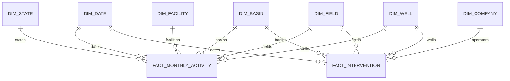

# Star Schema

The model uses conformed date, state, basin, field, well, facility, and operator dimensions. Production and intervention facts keep their individual grains.

The V11.1 source archive includes the complete dimensional model and validation notes.
